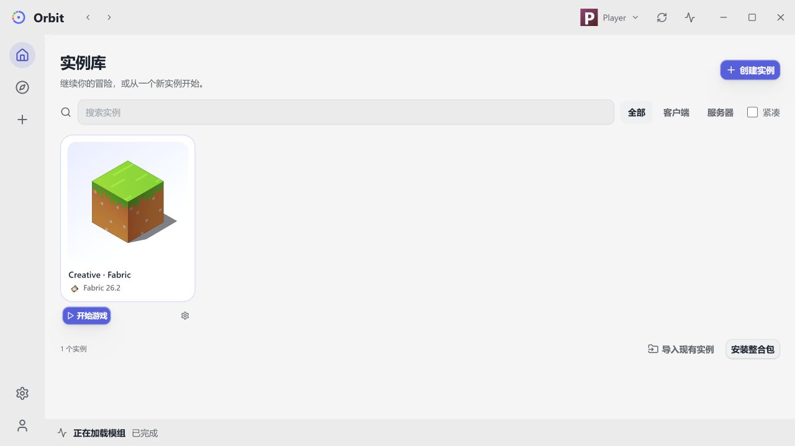
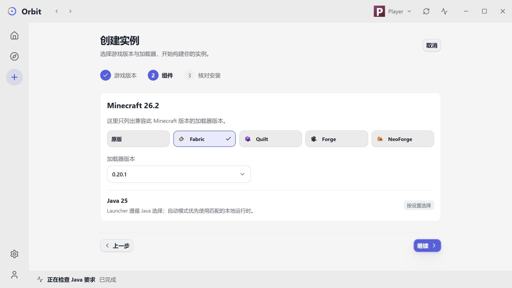

<p align="center">
  
</p>

# Orbit

[English](README.md) · [下载](https://github.com/water2004/orbit/releases) · [文档](docs/orbit-cli-commands.md)

**Minecraft 模组管理、运行时管理与桌面工作区，职责清晰、各自独立。**

Orbit 本体的目标没有改变：非侵入式管理现有合法 Minecraft 实例中的模组，不要求用户更换
启动器。套件同时提供独立的 Launcher，以及封装两个 CLI 的图形界面。

| 程序 | 职责 |
| --- | --- |
| **Orbit**（`orbit`） | 模组、JAR 声明的依赖、版本约束、修复、更新、精确恢复、兼容性审计及包数据。 |
| **Orbit Launcher**（`orbit-launcher`） | Minecraft、加载器、Java、账户、隔离实例、启动和服务端监督运行，不求解或管理模组来源。 |
| **Orbit GUI**（`orbit-gui`） | 以实例为中心的 Vue/Tauri 桌面界面；所有业务使用终端用户同样的 CLI 命令和机器协议。 |

Launcher 不链接、不调用 Orbit。需要记录包数据归属时，由 Orbit 单向包装 Launcher 的现有
启动命令并注入自己的运行时 Agent。两个 CLI 也都能独立使用。

## 桌面工作区

实例库、绑定实例的模组发现、包与版本管理、账户、Java 选择、安装向导、整合包导入导出和
迁移都可在桌面操作。长任务提供真实进度、取消入口及明确的方案选择。





*图片为实际前端的中文界面，使用隔离演示数据；不是设计稿，也没有启动游戏。
界面同时支持英文与跟随系统语言。*

## Orbit 能做什么

- **以 JAR 为事实来源。** 包 ID、版本、依赖、运行环境和内置内容来自 Loader 元数据，
  不信任远端展示标签。Modrinth、CurseForge 负责定位下载；同一逻辑包可配置多个远端和本地文件。
- **同步、恢复、修复分工明确。** `sync` 如实记录本地状态并可联网恢复来源；`install`
  精确恢复 lock；`fix` 求解依赖问题。同步和安装不会暗中修复实例。
- **提供真正的选择。** add/fix 最小化变动，全部更新求 Pareto 极大版本前沿；单包更新
  优先达到目标包的最高可行版本，再最小化其它包变动。独立选择因式分解，不展开巨大的
  笛卡尔列表；必要的降级、替换和删除在应用前明确展示、确认。
- **不用改 TOML 也能管理版本。** 查看远端实际 JAR 版本、设置数字约束、组合字符串过滤，
  并启用或禁用包。GUI 提供可视化规则编辑。
- **解释兼容风险。** audit 按不同 Loader 的运行时、命名空间和 Mixin 规则分析字节码。
  这是静态风险报告，不保证整合包一定能够正常运行。
- **明确处理包数据。** 可选的运行时观测只记录成功写入，不监听读取；可浏览、重置、
  purge 或迁移已知包数据。未知所有权保留，实例外路径不进入便携迁移。
- **减少重复请求和分析。** 按准确游戏版本/Loader 隔离的远端索引、JAR 解析数据库，
  与全局按哈希寻址的 LRU JAR 缓存各司其职。

## Launcher 能做什么

- 按官方元数据/安装器适配安装 Vanilla、Fabric、Quilt、Forge、NeoForge，具体受支持版本范围约束。
- 客户端使用 `instances/<名称>` 版本隔离：Minecraft JAR 和可变数据属于实例，共享不可变
  libraries/assets；独立服务端使用明确选择的服务器目录。
- 自动模式优先使用适用的**本地 Java**，缺失时才安装 Mojang Java；全局和单实例均可显式指定。
- 支持 Microsoft、离线、标准 External Yggdrasil 账户。令牌进入操作系统秘密存储，
  项目自己的 Microsoft public-client 注册信息已经内置。
- 支持客户端分辨率设置、服务端监督运行和可选的崩溃重启；安装服务端时完整展示并明确确认当前 EULA。
- **导入已有客户端实例。** 支持标准/官方 profile、HMCL、PCL、Prism/MultiMC、
  CurseForge、GDLauncher Carbon、ATLauncher 和已适配的 Modrinth App 存储布局。
  先预览实际游戏目录，再复制到新的隔离实例，原文件保留；无法取得全局隔离设置时要求
  用户明确选目录，不做猜测。
- **完整删除实例。** 与“仅从列表移除”分开，确认后将包括世界和模组在内的整目录移入
  系统回收站；失败不会悄悄退回永久删除。

外部导入只是把模组当作不透明用户文件复制，不管理或求解它们；不自动转换任意定制运行时
或服务端发行包。准确范围与中断恢复规则见[已有实例导入与删除](docs/orbit-launcher-import.md)。

## 安装

在 [GitHub Releases](https://github.com/water2004/orbit/releases) 下载发布包。

- **Windows x64：** 一个 MSI，提供仅 Orbit、Orbit + Launcher、完整套件三个档位；
  支持可选 PATH 集成、同版本维护，以及卸载时的数据清理选择。
- **Debian / Ubuntu amd64：** `orbit`、`orbit-launcher`、`orbit-gui` 三个独立 deb。
  无图形服务器只装 Launcher，需要模组管理再加 Orbit；GUI 依赖同版本的两个 CLI，并需要图形会话。

Windows GUI 使用 WebView2，Linux 使用 WebKitGTK 4.1。服务端 supervisor 不包含系统服务、
开机自启或退出登录后继续运行。

## 快速开始

### 接管现有游戏目录的模组

```sh
cd /path/to/your/game-directory
orbit init survival
orbit sync
orbit add sodium
orbit package sodium versions
orbit upgrade sodium
```

| 命令 | 作用 |
| --- | --- |
| `orbit sync` | 从实际运行时与本地 JAR 重建事实，联网识别已知远端；不求解、不删 JAR。 |
| `orbit fix` | 求解并确认最小变动的依赖修复。 |
| `orbit install` | 严格恢复已有 lock，不求解。 |
| `orbit outdated` / `orbit upgrade` | 检查/执行全局更新，同时解释受阻原因。 |
| `orbit upgrade <mod_id>` | 优先更新指定包，再最小化其它变动。 |
| `orbit package <mod_id> constraint set …` | 以同一事务求解并应用版本策略；失败或取消不写入策略。 |
| `orbit package <mod_id> disable` / `orbit package <mod_id> enable` | 原子重命名所选 JAR 并记录状态，改变 Loader 是否发现它。 |
| `orbit audit` | 只读的字节码兼容风险分析。 |
| `orbit package <mod_id> reset` / `orbit package <mod_id> purge` | 确认后仅重置包数据，或移除包及已观测的所属数据。 |

### 新建或导入实例

```sh
# 新建隔离客户端；可在 GUI 或 versions 命令中选择具体版本。
orbit-launcher install --new survival --kind client \
  --minecraft latest-release --loader fabric --loader-version stable

# 先检查和预览其它启动器的实例。
orbit-launcher instance inspect --directory /path/to/source
orbit-launcher instance import --directory /path/to/source \
  --source <inspect返回的ID> --name imported --dry-run
# 确认后去掉 --dry-run 再执行。

# 独立服务端；需要明确接受完整 EULA。
orbit-launcher install --new server --kind server --server-directory /srv/minecraft \
  --minecraft latest-release --loader fabric --loader-version stable
```

`instance unregister` 只注销实例；`instance delete --dry-run` 预览整个目录的删除范围。
没有 `--yes` 时，终端会再次要求确认。

### 整合包与迁移

`.orbitbundle` 是一种版本化组合包格式，可选包含彼此独立的 Orbit 和 Launcher 部分。
Orbit 管模组、约束、lock 和选中的包数据；Launcher 管运行时要求、世界和游戏偏好。
GUI 编排已有命令，将它们组合导出或迁移到**新实例**；也支持官方 Modrinth `.mrpack` 导入导出。

迁移先尝试保留所有源包；无解时才询问是否搜索最小删包方案，不静默覆盖已有实例或原地跨版本升级。

## 配置与自动化

`orbit.toml` 记录所有受管顶层逻辑包及策略，`orbit.lock` 如实记录精确选择。
一起纳入版本控制即可精确恢复；不区分根包与传递包。

CurseForge 必须配置用户自己的 API key，没有匿名兜底：

```sh
orbit config set auth.curseforge-api-key YOUR_API_KEY
```

也可用 `ORBIT_CURSEFORGE_API_KEY`，避免将密钥留在 shell 历史中。
全局配置、缓存容量、Java 等均可通过 CLI 或 GUI 管理。

两个 CLI 都支持 `--language system|en|zh-CN`（缺省 system）、`--output-format json` 和
`--progress-format ndjson`。结构化 stdout/stderr 与交互 stdin 使用严格 UTF-8，GUI
不走另一套业务 API。已发布的 Launcher 存储从 v0.7.0 起，通过独立的有序迁移模块升级，
替换前保留备份。

## 文档与开发

- [Orbit 命令](docs/orbit-cli-commands.md) · [Launcher 命令](docs/orbit-launcher-cli.md)
- [已有实例导入与删除](docs/orbit-launcher-import.md)
- [TOML 规范](docs/orbit-toml-spec.md) · [版本规则](docs/orbit-versions.md)
- [组合包格式](docs/orbit-bundle-format.md) · [字节码审计](docs/orbit-bytecode-audit.md)
- [GUI 架构与构建](docs/orbit-gui.md) · [项目架构](docs/orbit-architecture.md)
- [Windows MSI](docs/windows-msi.md) · [Linux deb](docs/linux-deb.md) · [发布流程](docs/release-process.md)

```sh
npm --prefix orbit-gui/ui ci
npm --prefix orbit-gui/ui test
npm --prefix orbit-gui/ui run build
cargo test --workspace
cargo clippy --workspace --all-targets -- -D warnings
```

贡献请遵循[项目规范](CLAUDE.md)，保持 CLI/core/wrapper 的依赖边界，并为 Loader 特有
行为编写测试。[PubGrub fork](https://github.com/water2004/pubgrub) 提供求解原语，
求解策略不在 GUI 中实现。

## 许可证

Orbit 和 Orbit Launcher 使用 MIT。GUI 因改造 Modrinth App 组件而使用 GPL-3.0-only；
参见 [GUI 许可证](orbit-gui/ui/LICENSE)、[上游来源](orbit-gui/ui/UPSTREAM.md) 和
[截图说明](assets/screenshots/README.md)。
